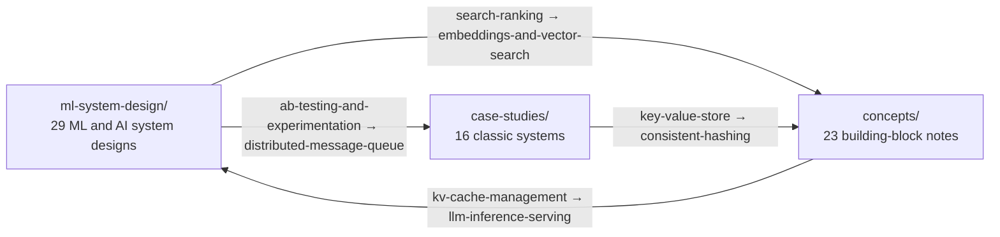
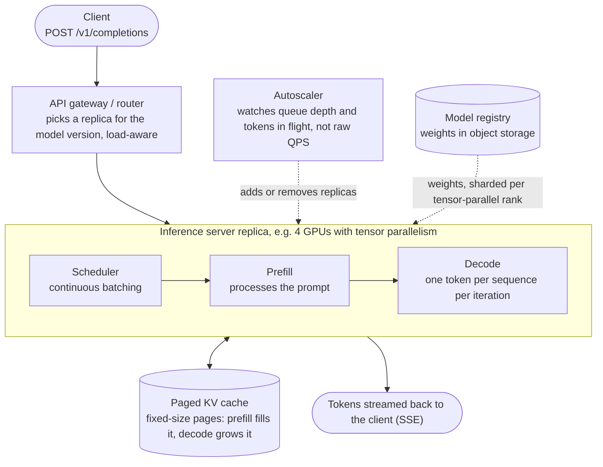

# high-level-design

System design notes I kept while prepping, in three parts:

- [`ml-system-design/`](#ml-system-design): 29 designs for ML and AI systems, from LLM serving and
  training to feature stores, GPU scheduling, ranking and fraud detection.
- [`case-studies/`](#case-studies): 16 of the usual interview systems, worked end to end.
- [`concepts/`](#concepts): 23 short notes on the building blocks, from caching and sharding to
  KV cache management and GPU scheduling.

Every design doc has the same seven sections: requirements, capacity estimation, API design, data
model, high-level architecture, deep dives, and bottlenecks and scaling. The estimations use real
numbers rather than hand-waving, and the designs point back at the concept notes instead of
re-explaining the same pattern every time.

An arrow means docs in one part point to docs in the other ("see concepts/consistent-hashing.md").
Each label is one real example.

## ML system design

### LLM and retrieval

| Doc | Summary |
|---|---|
| [llm-inference-serving](ml-system-design/llm-inference-serving.md) | Serve text generation from a 70B-class decoder-only model behind a request/response API and a streaming API. |
| [rag-system](ml-system-design/rag-system.md) | Retrieve relevant passages from a large document corpus and use them to ground an LLM answer, with citations back to the sources. |
| [rag-evaluation-platform](ml-system-design/rag-evaluation-platform.md) | Evaluate retrieval quality (recall@k, MRR, precision) and generation quality (faithfulness, correctness, relevance) separately, against curated golden query sets. |
| [llm-agent-orchestration](ml-system-design/llm-agent-orchestration.md) | Run multi-step tasks that interleave LLM reasoning calls with tool calls (search, code execution, internal APIs, sub-agents) until the task is done or a stop condition is reached. |
| [vector-search-system](ml-system-design/vector-search-system.md) | Return the top-k approximate nearest neighbors for a query vector from up to a billion vectors, by cosine or L2 similarity. |
| [embedding-service](ml-system-design/embedding-service.md) | Generate dense embeddings for text, images or queries, both one query at a time on a latency budget and for whole corpora offline. |

### Serving, rollout and experimentation

| Doc | Summary |
|---|---|
| [inference-gateway](ml-system-design/inference-gateway.md) | One stable client-facing API in front of many model backends (LLM servers, classic rankers, embedding models), routing each request by model name and version. |
| [model-serving-platform](ml-system-design/model-serving-platform.md) | Host hundreds of models from many teams on shared serving infrastructure, instead of each team running its own fleet. |
| [multi-tenant-gpu-serving](ml-system-design/multi-tenant-gpu-serving.md) | Serve hundreds to thousands of tenants' models on a shared GPU pool, each scaling on its own, down to zero when idle. |
| [model-rollout-canary](ml-system-design/model-rollout-canary.md) | Move a new model version to full traffic through shadow, canary, staged ramp and full stages, each gated on measured metrics, not a timer. |
| [mlops-model-cicd](ml-system-design/mlops-model-cicd.md) | Build, evaluate and progressively deploy a new model artifact, triggered by a finished training run or a code or data change. |
| [ml-monitoring-and-drift](ml-system-design/ml-monitoring-and-drift.md) | Watch every production model's input features and predictions for statistically significant drift from the training data or a recent baseline. |
| [ab-testing-and-experimentation](ml-system-design/ab-testing-and-experimentation.md) | Assign users to variants deterministically by allocation and targeting rules, and send metric events tagged with the variant to analysis. |

### Training and GPU infrastructure

| Doc | Summary |
|---|---|
| [distributed-training-system](ml-system-design/distributed-training-system.md) | Train a 70B-parameter decoder-only model on a multi-trillion-token dataset across hundreds to thousands of GPUs. |
| [distributed-training-orchestrator](ml-system-design/distributed-training-orchestrator.md) | Schedule many training jobs on a shared GPU cluster, admitting a job only when all of its resources are free at once (gang scheduling). |
| [llm-training-platform](ml-system-design/llm-training-platform.md) | A self-service API for any team to submit pretraining, fine-tuning or preference-tuning (DPO) jobs to a shared GPU cluster. |
| [gpu-cluster-scheduler](ml-system-design/gpu-cluster-scheduler.md) | Allocate whole or MIG-partitioned GPUs to training jobs, inference deployments and dev sessions from many teams on one shared cluster. |
| [gpu-fleet-autoscaler](ml-system-design/gpu-fleet-autoscaler.md) | Scale GPU capacity for each workload (inference, training, batch scoring) on its own demand signal, not one fleet-wide rule. |
| [ml-experiment-tracking-platform](ml-system-design/ml-experiment-tracking-platform.md) | Log training runs (hyperparameters, metrics over time, code version, environment) and track lineage from dataset version to model artifact. |

### Features and data pipelines

| Doc | Summary |
|---|---|
| [feature-store](ml-system-design/feature-store.md) | Define a feature once and use it in both offline training and online serving, without writing the transformation twice. |
| [feature-platform](ml-system-design/feature-platform.md) | The streaming and batch pipelines upstream of the feature store, plus the tooling (definitions, catalog, backfill, versioning) that lets hundreds of engineers ship features. |
| [real-time-ml-pipeline](ml-system-design/real-time-ml-pipeline.md) | Compute rolling counts, aggregates and ratios from a live event stream in near real time, and write them to an online and an offline feature store. |
| [online-learning-system](ml-system-design/online-learning-system.md) | Update a production model continuously from a stream of labeled events, instead of only through periodic batch retraining. |

### Applied ML systems

| Doc | Summary |
|---|---|
| [recommendation-system](ml-system-design/recommendation-system.md) | Return a ranked list of items a user is likely to engage with, for surfaces like the home feed, related items and search re-ranking. |
| [search-ranking](ml-system-design/search-ranking.md) | Rank results for a query from a corpus too large to score in full, as a funnel: retrieval, L1 ranking, L2 ranking, then business-logic re-ranking. |
| [realtime-personalization](ml-system-design/realtime-personalization.md) | Personalize a ranked list within a single session, using actions taken seconds ago, not only long-term profile signals. |
| [ad-click-prediction](ml-system-design/ad-click-prediction.md) | Predict the click probability (pCTR) of each candidate ad for every ad request; pCTR feeds the ad auction directly. |
| [fraud-detection-system](ml-system-design/fraud-detection-system.md) | Score every payment transaction inline in the authorization path, and approve, decline or send it to manual review. |
| [content-moderation-system](ml-system-design/content-moderation-system.md) | Classify uploaded text, images, video and audio against a policy taxonomy, with a confidence score per category. |

### Example: LLM inference serving

This is the high-level architecture from
[llm-inference-serving](ml-system-design/llm-inference-serving.md), redrawn in Mermaid:

## Case studies

| Doc | Summary |
|---|---|
| [url-shortener](case-studies/url-shortener.md) | Generate a short unique alias for a long URL and redirect visitors to it, with optional custom aliases, expiry and click analytics. |
| [rate-limiter](case-studies/rate-limiter.md) | Limit how many requests a client (API key, user ID or IP) can make in a time window, and reject the rest with HTTP 429 and a retry hint. |
| [key-value-store](case-studies/key-value-store.md) | A distributed store whose whole API is `put`, `get` and `delete`, over values that are opaque blobs. |
| [distributed-cache](case-studies/distributed-cache.md) | `get`, `set` with a TTL and `delete`: designing something like Redis or Memcached at distributed scale. |
| [distributed-message-queue](case-studies/distributed-message-queue.md) | Producers publish to topics and consumers read them, with work-queue and pub/sub semantics, persistence, and ordering within a partition. |
| [notification-system](case-studies/notification-system.md) | Send push, email, SMS and in-app notifications, triggered or scheduled, while respecting user preferences and avoiding duplicates. |
| [web-crawler](case-studies/web-crawler.md) | Crawl from seed URLs: fetch pages, extract links and content, respect `robots.txt` and crawl-rate policies, and skip unchanged content. |
| [search-autocomplete](case-studies/search-autocomplete.md) | Suggest completions after each keystroke, ranked by popularity and the user's own history, and updated as trends shift. |
| [twitter-news-feed](case-studies/twitter-news-feed.md) | Users post short updates and follow others; the home feed shows recent posts from everyone they follow. |
| [instagram](case-studies/instagram.md) | Upload photos and videos with a caption, follow users and see their posts in a feed, like and comment, and view profile grids. |
| [whatsapp-chat](case-studies/whatsapp-chat.md) | Real-time one-to-one and group messaging, with offline delivery, sent, delivered and read receipts, and media. |
| [youtube-video-streaming](case-studies/youtube-video-streaming.md) | Upload and process video, then stream it at a quality that fits each viewer's bandwidth and device. |
| [google-drive-dropbox](case-studies/google-drive-dropbox.md) | Upload, organize, share and sync files across devices, with version history and efficient sync of small edits to large files. |
| [uber](case-studies/uber.md) | Match riders to nearby drivers, show both sides each other's live location during the ride, and price trips with surge. |
| [ticketmaster](case-studies/ticketmaster.md) | Browse events and seat maps, hold seats during checkout, buy them, and release holds that expire. |
| [payment-system](case-studies/payment-system.md) | Move money from payer to payee through an external processor, with refunds and idempotent retries that never double-charge. |

## Concepts

### Distributed systems

| Note | Summary |
|---|---|
| [back-of-envelope-estimation](concepts/back-of-envelope-estimation.md) | Estimate the order of magnitude, because that decides the whole architecture; precision is not the point. |
| [load-balancing](concepts/load-balancing.md) | Decide which backend serves each request: spread load evenly, avoid dead or overloaded servers, and scale out by adding boxes. |
| [caching](concepts/caching.md) | Trade staleness for speed by serving a cheaper, faster copy; the work is balancing hit rate, staleness and complexity. |
| [cdn](concepts/cdn.md) | Servers spread around the world cache content close to users, which cuts latency and load on the origin. |
| [consistent-hashing](concepts/consistent-hashing.md) | Spread keys over nodes so that adding or removing a node remaps only about 1/N of the keys, unlike `hash(key) % N`. |
| [database-sharding](concepts/database-sharding.md) | Split one logical database into shards, once write throughput or data size outgrows a single primary. |
| [replication-and-consistency](concepts/replication-and-consistency.md) | Keep copies of data on several machines for durability and availability, and decide how the copies stay in sync. |
| [cap-theorem](concepts/cap-theorem.md) | During a network partition, a distributed system can offer consistency or availability, not both; partition tolerance is not optional. |
| [sql-vs-nosql](concepts/sql-vs-nosql.md) | Choose by the consistency, schema flexibility and scaling your access pattern needs; most large systems use both. |
| [indexing](concepts/indexing.md) | An index turns a full table scan into an O(log n) lookup, at the cost of extra work on every write and extra storage. |
| [message-queues](concepts/message-queues.md) | Decouple producers from consumers, so each side scales on its own, a slow consumer does not take the producer down, and bursts are smoothed out. |
| [rate-limiting](concepts/rate-limiting.md) | Cap how many requests a client can make in a window to protect a service; it is also a product lever for free and paid tiers. |
| [api-gateway](concepts/api-gateway.md) | A single entry point in front of backend services that handles auth, rate limiting, routing and request/response transformation. |

### ML systems

| Note | Summary |
|---|---|
| [llm-inference-optimization](concepts/llm-inference-optimization.md) | Generation needs one forward pass per token, so the levers are batching, quantization, the KV cache and speculative decoding. |
| [kv-cache-management](concepts/kv-cache-management.md) | How a paged KV cache is managed as a scarce resource: block allocation, what happens under memory pressure, and prefix sharing across requests. |
| [model-serving-patterns](concepts/model-serving-patterns.md) | Two separate decisions: how predictions are served (online, batch or streaming) and how a new version is rolled out (shadow, canary or bandit). |
| [autoscaling-inference](concepts/autoscaling-inference.md) | Why GPU inference autoscaling differs from web autoscaling: which signal to scale on, slow cold starts, and when scaling to zero is worth it. |
| [gpu-scheduling](concepts/gpu-scheduling.md) | Placing jobs that want whole GPUs, or several in lockstep: bin-packing, gang scheduling and isolation between jobs. |
| [distributed-training](concepts/distributed-training.md) | Data parallelism when the dataset takes too long on one device, model parallelism when the model does not fit in one device's memory. |
| [embeddings-and-vector-search](concepts/embeddings-and-vector-search.md) | Dense vectors where closeness means similar meaning, which turns "is this similar to that" into a nearest-neighbor search. |
| [data-versioning-and-lineage](concepts/data-versioning-and-lineage.md) | Name and fetch exact past states of datasets and features, get point-in-time values right, and trace each model back to what built it. |
| [mlops-and-model-cicd](concepts/mlops-and-model-cicd.md) | Ship models like code releases, with eval gates instead of unit tests and canary or shadow rollout, because a model can be silently wrong. |
| [model-monitoring-and-drift](concepts/model-monitoring-and-drift.md) | A model can degrade after rollout with no code change; monitoring catches data drift and concept drift before the business metrics do. |

## Contributing

New design docs and fixes are welcome. See [CONTRIBUTING.md](CONTRIBUTING.md) for the expected sections,
how to write capacity estimates, and how to draw diagrams in Mermaid.

## License

[CC BY 4.0](LICENSE). You can share and adapt these notes for any purpose, as long as you give credit.
